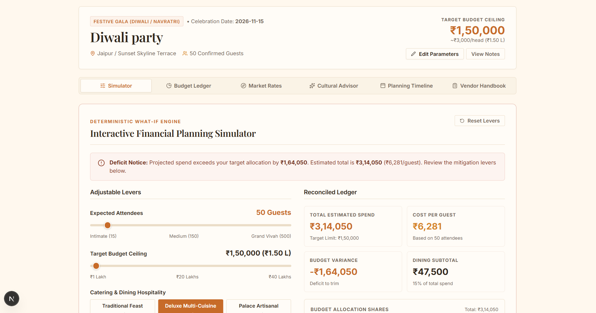
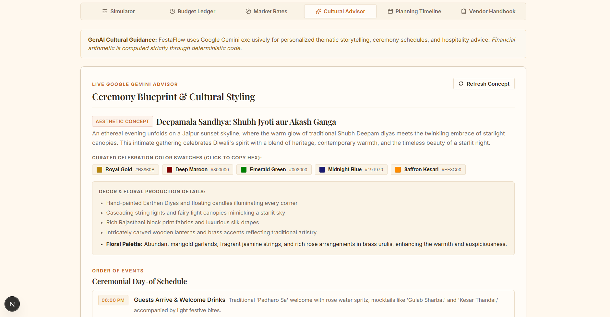

<div align="center">

# FestaFlow | फेस्टाफ्लो
### Celebrate beautifully. Plan intelligently.

**An intelligent Indian celebration planning and budget intelligence platform.**  
Harmonizing deterministic financial calculations with Google Gemini-powered cultural advisory.


<br/>


</div>

---

## 1. About FestaFlow

Planning Indian celebrations—from royal weddings and sangeet cocktails to griha pravesh ceremonies, milestone birthdays, and community festivals—is often derailed by hidden costs, arbitrary budgets, and fragmented vendor coordination.

FestaFlow replaces spreadsheet guesswork with an integrated planning system. It pairs a **deterministic budget engine** that accounts for 100% of funds with an **AI Cultural Advisor** powered by Google Gemini that generates bespoke themes, color palettes, and day-of schedules. Hosts gain complete financial and logistical clarity from initial concept to physical print.

---

## 2. Screenshots

| Celebration Dashboard | Interactive Budget Simulator |
| :---: | :---: |
|  |  |

| AI Cultural Advisor | Timeline & Vendor Handbook |
| :---: | :---: |
|  |  |

---

## 3. Key Features

- **Multi-Occasion Presets & Custom Plans:** Pre-configured setups for Royal Vivahs, Bollywood Sangeet, Haldi & Mehendi, Griha Pravesh, 50th Birthdays, Diwali Galas, and clean blank plans.
- **Deterministic Budget Intelligence:** Interactive levers for guest count, target budget, and service tiers (catering, decor, entertainment, rituals, attire). Every allocation reconciles mathematically to 100% with explicit contingency reserves (5–15%).
- **Indicative Market Benchmarks:** Curated reference ranges (Jaipur, Rajasthan, and Pan-India) across catering, heritage venues, mandap decor, photography, and sound.
- **Gemini AI Cultural Advisor:** Generates bespoke theme concepts, hex color swatches, day-of activity schedules, and hospitality etiquette with built-in offline curated fallbacks.
- **Interactive Timeline & Vendor Handbook:** Phase-based milestone tracking (Planning, Booking, Logistics, Day-of) and vendor worksheets equipped with crucial negotiation questions.
- **Persistence, Portability & Print Ready:** Debounced 650ms `localStorage` auto-save, JSON import/export, multi-currency display (INR ₹, USD $, EUR €, GBP £ with Indian Lakhs/Crores notation), and a clean print dossier stylesheet.

---

## 4. What Makes FestaFlow Different

FestaFlow establishes a strict separation between **financial arithmetic** and **generative AI**:

| Capability | FestaFlow Deterministic Engine | Gemini Generative Advisory |
| :--- | :--- | :--- |
| **Domain** | Budget totals, per-guest rates, category splits, variance | Cultural concepts, color palettes, schedules, etiquette |
| **Execution** | Pure formula-driven TypeScript calculations (`budgetCalculations.ts`) | Server-side Gemini 2.5 Flash API route (`/api/ai-plan-advisor`) |
| **Guarantees** | Zero floating-point drift; allocations strictly total 100% | Creative contextual vision; strictly forbidden from generating costs |
| **Data Source**| Calibrated Indian baseline matrices & user sliders | Structured JSON schema with curated cultural knowledge base fallback |

---

## 5. Technology Stack

- **Framework:** Next.js 16.4.3 (App Router, Turbopack)
- **UI Library:** React 19.3.1 & React DOM 19.3.1
- **Language:** TypeScript 7.0.2 (Strict mode, ES2022)
- **AI Integration:** Google GenAI SDK (`@google/genai` v2.31.0) with model `gemini-2.5-flash`
- **Iconography:** Lucide React 1.61.0
- **Styling:** Design tokens with an authentic Indian aesthetic (warm ivory, sand beige, marigold terracotta, deep charcoal) and custom SVG rangoli motifs

---

## 6. How It Works

1. **Configure Ground Rules:** Choose a preset or define event type, guest count, target budget, region, and preferences in `EventSetupForm`.
2. **Simulate Budget:** Adjust guest counts and catering/decor/sound tiers in `BudgetSimulator` to see real-time surplus/deficit variance and actionable savings advice.
3. **Generate Cultural Blueprint:** Fetch bespoke themes, copyable hex palettes, and day-of schedules via the `AICulturalAdvisor`.
4. **Coordinate & Execute:** Track milestones in `TimelineSection`, compare vendor quotes in `VendorChecklist`, and print the final dossier for day-of coordination.

---

## 7. Important Architecture

```
src/
├── app/
│   ├── api/ai-plan-advisor/route.ts  # Server-side Gemini API route & fallback
│   ├── globals.css                   # Theme tokens, layout, print stylesheet
│   └── page.tsx                      # Root state coordinator, persistence & layout
├── components/
│   ├── AICulturalAdvisor.tsx         # Blueprint viewer & color swatch copy
│   ├── BudgetBreakdown.tsx           # Category distribution & 100% reconciliation
│   ├── BudgetSimulator.tsx           # Interactive sliders & variance levers
│   ├── EventSetupForm.tsx            # Celebration parameters & preset selector
│   ├── PlanDashboard.tsx             # Tabbed workspace coordinator
│   ├── TimelineSection.tsx           # Phase-based milestone checklist
│   └── VendorChecklist.tsx           # Vendor tracker & interview questionnaire
├── data/
│   ├── indianMarketCosts.ts          # Curated indicative Rajasthan/Pan-India benchmarks
│   └── samplePlan.ts                 # Occasion presets & initial milestones
└── utils/
    └── budgetCalculations.ts         # Pure deterministic calculation engine
```

---

## 8. Run Locally

### Prerequisites
- Node.js 18.18.0 or newer
- npm 9 or newer

### 1. Clone & Install
```bash
git clone https://github.com/YOUR_USERNAME/festaflow.git
cd festaflow
npm install
```

### 2. Configure Environment Variables
Copy the template file:
```bash
cp .env.example .env.local
```

Add your Google Gemini API key to `.env.local`:
```env
GEMINI_API_KEY=your_gemini_api_key_here
```
*(If omitted, FestaFlow runs using its rich built-in cultural fallback knowledge base).*

### 3. Start Development Server
```bash
npm run dev
```
Open [http://localhost:3000](http://localhost:3000) in your browser.

---

## 9. Security & Data Handling

- **Server-Side API Key:** `GEMINI_API_KEY` is loaded strictly server-side in Next.js Route Handlers and is excluded from client bundles.
- **Git Protection:** `.gitignore` excludes `.env*` (`.env.local`), `node_modules/`, and build artifacts.
- **Local Persistence:** Plan state is stored locally in the user's browser via `localStorage`. No personal event data is sent to external databases.

---

## 10. Project Information

Developed for **PromptWars Virtual Challenge 5**.  
*Celebrate beautifully. Plan intelligently.*
